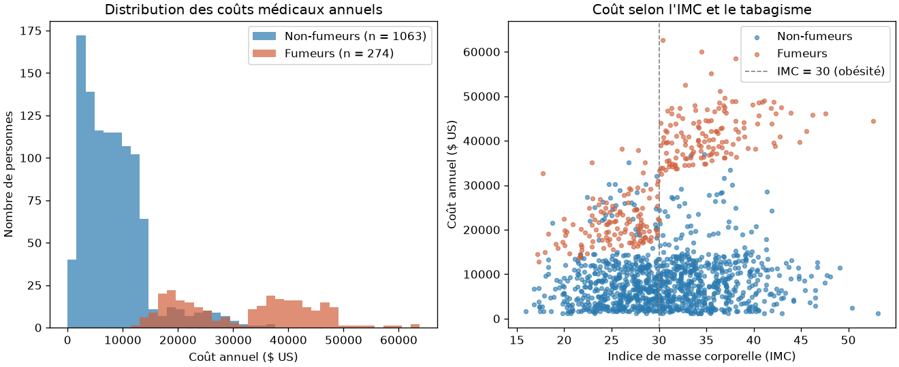
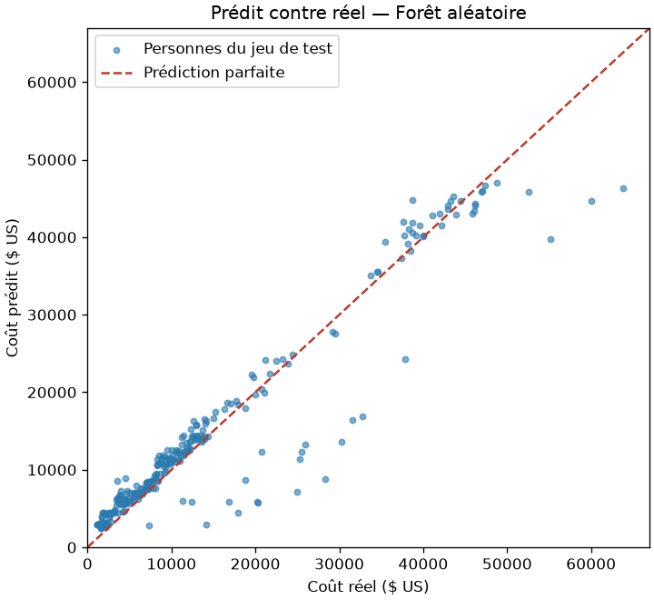

# Estimation du coût médical annuel — Projet 2 INF1007 (A2026)

**Auteur :** Guillaume Hardy (travail réalisé seul : le coéquipier a abandonné le cours).

Application Tkinter qui estime le **coût médical annuel facturé à l'assurance** d'une personne à partir de son âge, de son IMC, de son nombre d'enfants, de son sexe, de son statut de fumeur et de sa région de résidence (États-Unis). Un utilisateur peut voir comment ces facteurs, et surtout le tabagisme, font varier le coût estimé.

## Jeu de données

| | |
|---|---|
| Nom | *Medical Cost Personal Datasets* (`insurance.csv`) |
| Source | Kaggle, Miri Choi : <https://www.kaggle.com/datasets/mirichoi0218/insurance> ; données issues du livre *Machine Learning with R* de Brett Lantz (Packt), copie d'origine : <https://github.com/stedy/Machine-Learning-with-R-datasets> |
| Licence | Indiquée sur la page Kaggle : *Database: Open Database, Contents: Database Contents* (ODbL 1.0 / DbCL 1.0). Elle permet l'usage éducatif et la redistribution avec attribution, d'où la copie dans `donnees/assurance.csv` (55 Ko). |
| Taille | 1 338 lignes (1 337 après nettoyage), 6 caractéristiques + 1 cible |
| Caractéristiques | numériques : `age`, `bmi`, `children` ; catégorielles : `sex`, `smoker`, `region` |
| Cible | `charges` : coût médical annuel en dollars US (**régression**) |
| Données personnelles | aucune : pas de nom, d'adresse ni d'identifiant ; les données sont **simulées** à partir de statistiques du Bureau du recensement des États-Unis. |

## Installation et lancement (Windows, Python 3.11)

```powershell
git clone https://github.com/<votre-compte>/projet2-inf1007.git
cd projet2-inf1007
py -3.11 -m venv .venv
.venv\Scripts\activate
pip install -r requirements.txt

python src/main.py               # ouvre l'interface
python src/main.py --entrainer   # ré-entraîne le modèle et affiche les résultats
pytest                           # lance les tests
coverage run -m pytest ; coverage report   # mesure la couverture
```

Le modèle entraîné (`modeles/modele.joblib`) et ses métadonnées (`modeles/metadonnees.json`) sont versionnés : l'interface les charge sans ré-entraîner. S'ils sont absents ou illisibles (par exemple avec une autre version de scikit-learn), `main.py` les régénère une seule fois.

## Structure du code

```
projet2-inf1007/
├── README.md, DECISIONS.md, JOURNAL_IA.md, requirements.txt, pytest.ini, .coveragerc
├── .github/workflows/tests.yml   # CI : pytest + coverage à chaque push
├── donnees/assurance.csv         # jeu de données
├── modeles/                      # modèle .joblib + métadonnées JSON
├── figures/                      # graphiques enregistrés (savefig)
├── historique/predictions.csv    # créé à la première prédiction (non versionné)
├── src/
│   ├── exceptions.py   # ErreurProjet, DonneeInvalideError, FichierIntrouvableError, ModeleNonEntraineError
│   ├── donnees.py      # JeuDeDonnees : lecture par blocs (générateur), nettoyage, séparation
│   ├── variables.py    # Variable (abstraite) → VariableNumerique, VariableCategorielle
│   ├── modele.py       # ModeleAssurance, métriques NumPy, décorateur @chronometrer
│   ├── historique.py   # Historique : ajout et lecture du CSV des prédictions
│   ├── graphiques.py   # figures Matplotlib (exploration, prédit/réel, importance, position)
│   ├── entrainement.py # démarche complète : données → modèles → évaluation → sauvegarde
│   ├── interface.py    # Application (Tkinter)
│   └── main.py         # point d'entrée
└── tests/              # test_variables.py, test_donnees.py, test_modele.py
```

**Programmation orientée objet**
- Classes : `JeuDeDonnees`, `ModeleAssurance`, `Historique`, `Variable`, `VariableNumerique`, `VariableCategorielle`, `Application`.
- **Héritage et polymorphisme :** `Variable` est une classe abstraite (`ABC`). `VariableNumerique` et `VariableCategorielle` redéfinissent `valider()` et `decrire_contrainte()`. `valider_saisies()` appelle `variable.valider(...)` sans connaître le type de la variable.
- **Composition :** `Application` contient un `ModeleAssurance`, une liste de `Variable` et un `Historique`. `ModeleAssurance` contient un `Pipeline` scikit-learn.
- **Encapsulation :** attributs protégés (`_nom`, `_minimum`, `_pipeline`, `_donnees`…) exposés en lecture seule par des `@property`.
- **Méthodes spéciales :** `__str__`, `__repr__`, `__eq__`/`__hash__` (`Variable`), `__len__` (`JeuDeDonnees`, `Historique`).

**Séparation calcul / entrées-sorties :** `interface.py` ne fait que lire les champs, appeler `valider_saisies()` puis `ModeleAssurance.predire()` et afficher le résultat. Toute la logique est dans les autres modules, ce qui la rend testable sans interface.

## Outils du chapitre 7 utilisés

- **Décorateur** `@chronometrer` (`modele.py`) : il mesure la durée d'entraînement de chaque modèle sans modifier le code de `entrainer()`. Les durées sont enregistrées dans les métadonnées.
- **Générateur** `lire_csv_par_blocs()` (`donnees.py`) : il lit le CSV par blocs de 500 lignes avec `yield`, ce qui permettrait de traiter un fichier trop gros pour la mémoire.
- **Lambda** comme clé de tri : `trier_importances()` (variables triées par importance), `Historique.lire()` (prédictions triées par date) et le choix du meilleur modèle dans `entrainement.py`.

## Démarche et résultats du modèle

1. **Exploration et nettoyage :** aucune valeur manquante. **1 doublon exact retiré** (un doublon donnerait plus de poids à cette personne et pourrait se retrouver à la fois dans l'entraînement et dans le test). Le texte des catégories est normalisé (espaces, majuscules). Les valeurs physiquement impossibles (IMC < 10 ou > 80, etc.) seraient retirées, mais il n'y en a aucune. Les **139 valeurs aberrantes de la cible** (règle 1,5 × IQR) sont **conservées** : ce sont surtout des fumeurs, donc de vrais cas que le modèle doit apprendre.
   
   *Le tabagisme sépare les coûts en deux groupes, et chez les fumeurs le coût bondit au-delà d'un IMC de 30.*
2. **Problème :** régression sur `charges`. **Métrique principale : MAE** (erreur absolue moyenne), exprimée en dollars, donc compréhensible par un non-informaticien. RMSE et R² sont aussi rapportés. Les trois métriques sont calculées avec NumPy (vectorisé) et vérifiées contre scikit-learn dans les tests.
3. **Séparation :** 80 % entraînement (1 069 lignes) / 20 % test (268 lignes), `random_state=42`.
4. **Référence :** `DummyRegressor` qui prédit toujours la moyenne.
5. **Modèles comparés** (prétraitement `OneHotEncoder` dans un `Pipeline`) :

| Modèle (ensemble de test) | MAE | RMSE | R² |
|---|---:|---:|---:|
| Référence (moyenne) | 9 862 $ | 13 612 $ | −0,01 |
| Régression linéaire | 4 177 $ | 5 956 $ | 0,81 |
| **Forêt aléatoire** (200 arbres, profondeur ≤ 5) — **retenue** | **2 420 $** | **4 244 $** | **0,90** |

   La forêt divise l'erreur de la référence par 4. Elle bat la régression linéaire parce que l'effet de l'IMC dépend du tabagisme (interaction visible ci-dessus), ce qu'une régression linéaire sans terme d'interaction ne peut pas représenter. Dans 80 % des cas de test, l'erreur est inférieure à 2 575 $ : l'interface s'en sert pour afficher une *fourchette probable*.
   
6. **Importance des variables** (par permutation, sur le test) : fumeur ≫ IMC > âge ; enfants, région et sexe n'ont presque aucun effet.

**Limites :** seulement 1 337 personnes, données simulées et américaines (2003 environ), aucune information sur l'état de santé réel. Quelques personnes ont des coûts très élevés que le modèle sous-estime (les points au-dessus de la diagonale). Le modèle ne fonctionne que dans les intervalles observés : l'interface refuse par exemple un âge de 70 ans.

## Interface

- Le formulaire est **construit à partir de `metadonnees.json`** : champ texte pour les variables numériques (intervalle affiché dessous), liste déroulante pour les catégorielles.
- Validation : une saisie vide, non numérique, non entière ou hors intervalle affiche un message clair en rouge. Toutes les erreurs sont listées en même temps, sans plantage.
- Le bouton **Prédire** (ou Entrée) affiche le coût estimé et une fourchette probable en langage courant.
- Graphique Matplotlib intégré : position de l'estimation dans la distribution des coûts. L'onglet *À propos du modèle* affiche l'importance des variables et les scores.
- Historique : chaque prédiction est ajoutée à `historique/predictions.csv` et consultable dans l'onglet *Historique*. Refaire une prédiction avec exactement les mêmes données que la précédente n'ajoute pas de ligne.
- Un bandeau d'avertissement est affiché en permanence (domaine santé/assurance).

## Tests et couverture

64 tests pytest (cas usuels, cas limites, cas d'erreur avec `pytest.raises`, flottants avec `pytest.approx`) répartis dans `tests/`.

| Mesure (`coverage run -m pytest ; coverage report`) | Couverture |
|---|---:|
| Logique (tous les modules sauf `interface.py` et `main.py`, exclus dans `.coveragerc`) | **94 %** |
| Tout `src/`, interface comprise | 70 % |

L'interface est testée manuellement (cas normal, saisie invalide, historique), comme le prévoit l'énoncé (« tests sur la logique, hors interface »).

## Documentation officielle consultée

- pandas, *10 minutes to pandas* et `read_csv` (paramètre `chunksize`) : <https://pandas.pydata.org/docs/user_guide/10min.html>, <https://pandas.pydata.org/docs/reference/api/pandas.read_csv.html>
- scikit-learn, *Getting started*, `ColumnTransformer`/`Pipeline`, `RandomForestRegressor`, *Permutation feature importance*, *Model persistence* : <https://scikit-learn.org/stable/getting_started.html>, <https://scikit-learn.org/stable/modules/compose.html>, <https://scikit-learn.org/stable/modules/permutation_importance.html>, <https://scikit-learn.org/stable/model_persistence.html>
- Tkinter (`tkinter`, `tkinter.ttk`) : <https://docs.python.org/3/library/tkinter.html>, <https://docs.python.org/3/library/tkinter.ttk.html>
- Matplotlib, *Embedding in Tk* : <https://matplotlib.org/stable/gallery/user_interfaces/embedding_in_tk_sgskip.html>
- pytest (`pytest.raises`, `pytest.approx`, `tmp_path`) : <https://docs.pytest.org/> ; GitHub Actions pour Python : <https://docs.github.com/actions/automating-builds-and-tests/building-and-testing-python>

## Fichiers complémentaires

- [DECISIONS.md](DECISIONS.md) : fiche de décisions.
- [JOURNAL_IA.md](JOURNAL_IA.md) : journal d'utilisation de l'IA.
